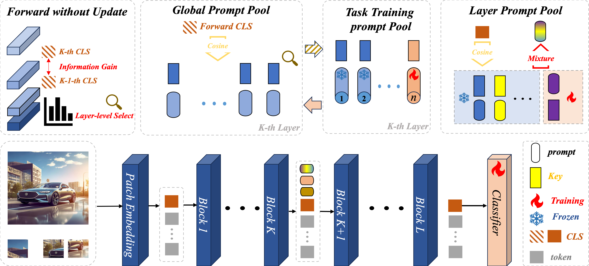

# LDEPrompt: Layer-importance guided Dual Expandable Prompt Pool for Pre-trained Model-based Class-Incremental Learning

> **昇腾 910B NPU 适配版本**：当前分支在原有 PyTorch 实现之外新增了 MindSpore/CANN 单卡实现，适配华为昇腾 910B。原 PyTorch 入口 `main.py` 与旧代码保持兼容，NPU 入口为 `main_mindspore.py`。完整安装、启动和实验说明见 [docs/ASCEND_910B.md](docs/ASCEND_910B.md)。

Prompt-based class-incremental learning methods typically construct a prompt pool consisting of multiple trainable keyprompts and perform instance-level matching to select the most suitable prompt embeddings, which has shown promising results. However, existing approaches face several limitations, including fixed prompt pools, manual selection of prompt embeddings, and strong reliance on the pretrained backbone for prompt selection. To address these issues, we propose a Layer-importance guided Dual Expandable Prompt Pool (LDEPrompt), which enables adaptive layer selection as well as dynamic freezing and expansion of the prompt pool. Extensive experiments on widely used classincremental learning benchmarks demonstrate that LDEPrompt achieves state-of-the-art performance, validating its effectiveness and scalability.


## 昇腾 910B NPU 适配（MindSpore/CANN）

本分支提供一套不依赖 PyTorch/CUDA 的 MindSpore 实现，目标设备为 Ascend 910B。实现覆盖 ViT-B/16 主干、前缀 Prompt、层次信息增益选层、可扩展 Prompt 池、任务路由、分类器对齐和 checkpoint 保存。

```bash
# 1. 准备 CANN 与匹配版本的 mindspore-ascend wheel，详见 docs/ASCEND_910B.md
source /usr/local/Ascend/ascend-toolkit/set_env.sh

# 2. 先在目标机上运行小型 smoke（小模型、三任务、单卡）
CONFIG=exps/smoke/ldeprompt_synthetic.json \
OUTPUT_DIR=runs/ascend-smoke \
bash scripts/run_ascend_910b.sh

# 3. 使用论文 JAX 权重转出的 MindSpore checkpoint 运行 CIFAR-100
python scripts/convert_jax_vit.py \
  --source /path/to/B_16-imagenet.npz \
  --output /path/to/vit_b16.ckpt

CONFIG=exps/ascend/cifar/ldeprompt.json \
BACKBONE_CHECKPOINT=/path/to/vit_b16.ckpt \
OUTPUT_DIR=runs/ascend-cifar \
bash scripts/run_ascend_910b.sh --seed 1993
```

可用实验配置：`exps/ascend/cifar/ldeprompt.json`、`exps/ascend/cub/ldeprompt.json`、`exps/ascend/vtab/ldeprompt.json`。

适配范围：Ascend 910B 单卡、MindSpore/CANN；仓库提供 22 项单元测试与三任务 smoke 运行入口。完整数据集、预训练权重和实验配置的用法见 `docs/ASCEND_910B.md`。

### Dataset
We provide the processed datasets as follows:
- **CIFAR100**: will be automatically downloaded by the code.
- **CUB200**:  Google Drive: [link](https://drive.google.com/file/d/1XbUpnWpJPnItt5zQ6sHJnsjPncnNLvWb/view?usp=sharing) or Onedrive: [link](https://entuedu-my.sharepoint.com/:u:/g/personal/n2207876b_e_ntu_edu_sg/EVV4pT9VJ9pBrVs2x0lcwd0BlVQCtSrdbLVfhuajMry-lA?e=L6Wjsc)
- **VTAB**: Google Drive: [link](https://drive.google.com/file/d/1xUiwlnx4k0oDhYi26KL5KwrCAya-mvJ_/view?usp=sharing) or Onedrive: [link](https://entuedu-my.sharepoint.com/:u:/g/personal/n2207876b_e_ntu_edu_sg/EQyTP1nOIH5PrfhXtpPgKQ8BlEFW2Erda1t7Kdi3Al-ePw?e=Yt4RnV)

You need to modify the path of the datasets in `./utils/data.py`  according to your own path.


## Running scripts

Please follow the settings in the `exps` folder to prepare json files, and then run:

```
python main.py --config ./exps/[datasets]/[filename].json
```

**Here is an example of how to run the code** 

if you want to run the cifar dataset using the released configuration, you can follow the script:
```
python main.py --config ./exps/cifar/ldeprompt.json
```


## Acknowledgment

We would like to express our gratitude to the following repositories for offering valuable components and functions that contributed to our work.

- [PILOT: A Pre-Trained Model-Based Continual Learning Toolbox](https://github.com/sun-hailong/LAMDA-PILOT)
